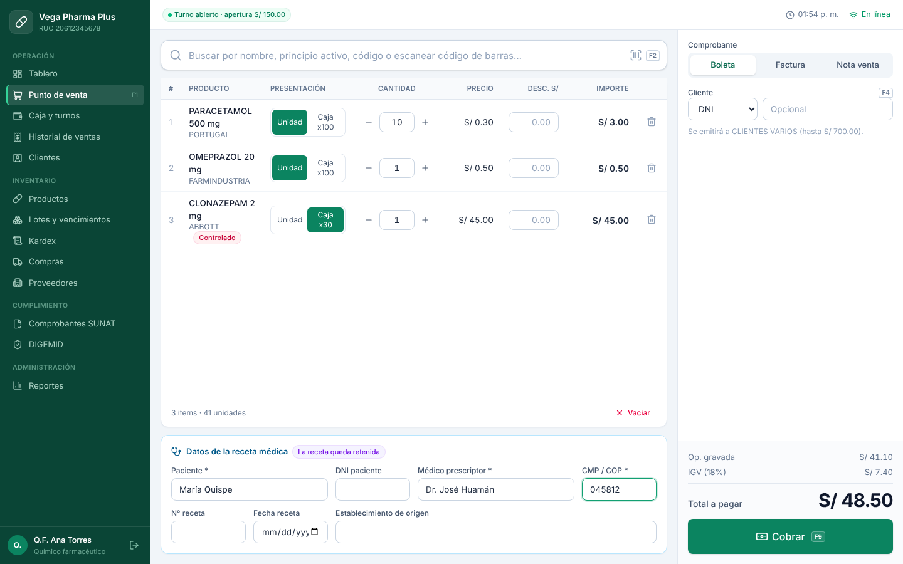

# Vega Pharma Plus · ERP para botica

Sistema web para la operación diaria de una botica en Perú, alineado con **SUNAT** (comprobantes electrónicos) y **DIGEMID** (recetas, controlados, vencimientos y Observatorio de Precios). Pensado para computadora de escritorio, con atajos de teclado y lector de código de barras.

**Stack:** Next.js 15 (App Router) · Supabase (Postgres + Auth + RLS) · Vercel · Tailwind CSS.



## Módulos

| Módulo | Qué hace |
|---|---|
| **Punto de venta** (`F1`) | Búsqueda por nombre, principio activo o código de barras; venta por unidad o por caja (fracción); descuentos; boleta, factura o nota de venta; pagos en efectivo con vuelto, **tarjeta por POS** (Izipay, Niubiz, OpenPay, Culqi, Mercado Pago u otro, con N° de operación), Yape, Plin, transferencia y **pagos mixtos**. El carrito sobrevive a una recarga. Atajos: `F2` buscar, `F4` cliente, `F9` cobrar, `Shift+Enter` agrega caja. |
| **Ventas con receta** | Productos marcados como *con receta*, *receta retenida* o *controlado* exigen paciente, médico y CMP; los controlados solo los dispensa el químico farmacéutico. |
| **Caja y turnos** | Apertura con fondo, ingresos/egresos, arqueo por denominaciones, diferencia y reporte de cierre imprimible (80 mm). Un turno por caja y por usuario. |
| **Historial de ventas** | Filtros, exportación CSV, reimpresión de ticket, **notas de crédito** (devuelven stock a los mismos lotes) y anulación de notas de venta. |
| **Facturación SUNAT** | Envío a través de un PSE (Nubefact incluido; la interfaz permite agregar otros sin tocar el resto del sistema). Ticket con QR SUNAT e importe en letras. Panel de pendientes, rechazados y reenvío. Si el proveedor no responde, la venta no se bloquea: queda *pendiente* y se reenvía (botón o cron diario). |
| **Productos** | Nombre, DCI, concentración, forma, presentación, laboratorio, **registro sanitario**, **código DIGEMID**, condición de venta, lista de control, unidades por caja, precios por unidad y caja, afectación IGV, stock mínimo, ubicación, cadena de frío. |
| **Lotes y vencimientos** | Stock por lote con salida **FEFO** automática (nunca vende lotes vencidos), alertas por vencer/vencidos, bajas por vencimiento, merma o devolución. |
| **Kardex** | Movimientos valorizados por producto y lote con saldo, usuario y referencia. Exportable. |
| **Compras y proveedores** | Registro por factura con lote y vencimiento por ítem, costo promedio ponderado y actualización opcional del precio de venta. |
| **DIGEMID** | Alertas sanitarias, **libro de recetas y controlados** (imprimible/exportable) y **archivo para el Observatorio de Precios**. |
| **Reportes** | Venta neta, utilidad y margen, ticket promedio, venta por día y hora, por medio de pago, por usuario, productos más vendidos, valorización del inventario. |
| **Usuarios** | Roles: administrador, químico farmacéutico, cajero y almacén. Todo queda registrado con el usuario; auditoría de cambios en productos, usuarios y configuración. |

### Observatorio de Precios (DIGEMID)

`DIGEMID → Observatorio de precios` genera el archivo que se sube en el portal del Observatorio:

- CSV UTF-8, separado por comas, fin de línea CRLF, cabecera exacta `CodEstab,CodProd,Precio 1,Precio 2`.
- `CodEstab`: código del establecimiento (7 dígitos, con ceros a la izquierda), se configura en *Configuración*.
- `CodProd`: código del producto en el catálogo DIGEMID (campo *Código DIGEMID* del producto).
- `Precio 1` = precio por empaque, `Precio 2` = precio por unidad, con 2 decimales.
- También se descarga en ZIP. Muestra qué productos quedan fuera y por qué, y permite validar los códigos contra el catálogo de DIGEMID en CSV.

> El formato se tomó del manual de carga de marzo de 2026 a través de una implementación pública. Haga una carga de prueba para confirmarlo; si DIGEMID cambia el formato, solo hay que ajustar `src/lib/observatorio.ts`.

## Puesta en marcha

### 1. Base de datos (Supabase)

1. En su proyecto de Supabase abra **SQL Editor → New query**, pegue el contenido de [`supabase/instalar.sql`](supabase/instalar.sql) y pulse **Run**. Crea tablas, funciones, vistas y seguridad (RLS). No carga datos de demostración.
2. En **Authentication → Sign In / Providers**, desactive **Allow new users to sign up**. Los usuarios se crean desde el propio ERP.
3. En **Authentication → Users → Add user → Create new user**, cree su usuario con correo y contraseña (marque *Auto confirm*). **El primer usuario creado es el administrador.**

Alternativa con CLI: `npx supabase link --project-ref <ref>` y `npx supabase db push`.

### 2. Despliegue (Vercel)

1. En Vercel: **Add New → Project → Import** este repositorio. El framework se detecta solo.
2. En **Environment Variables** cargue las de [`.env.example`](.env.example):
   - `NEXT_PUBLIC_SUPABASE_URL`, `NEXT_PUBLIC_SUPABASE_ANON_KEY` y `SUPABASE_SERVICE_ROLE_KEY` (Supabase → Project Settings → API).
   - `NUBEFACT_RUTA` y `NUBEFACT_TOKEN` cuando tenga la cuenta de facturación (mientras tanto las ventas quedan *pendientes*).
   - `CRON_SECRET`: un texto largo aleatorio.
3. **Deploy**. Entre con el usuario administrador y complete **Configuración** (RUC, razón social, dirección, código de establecimiento DIGEMID, director técnico, series por caja).

### 3. Facturación electrónica (Nubefact)

1. Cree una cuenta en nubefact.com con el RUC de la botica (tiene modo DEMO para pruebas).
2. En su panel, sección **API (Integración)**, copie la **RUTA** y el **TOKEN** y cárguelos en Vercel.
3. Registre en Nubefact las mismas series que en *Configuración* (por defecto `B001`, `F001`, `BC01`, `FC01`).

Para usar otro PSE/OSE, implemente `ProveedorFacturacion` en `src/lib/facturacion/` y regístrelo en `index.ts`.

## Desarrollo local

```bash
npm install
npx supabase start          # Postgres + Auth locales (Docker)
npx supabase db reset       # aplica migraciones + datos demo (supabase/seed.sql)
cp .env.example .env.local  # con las claves que imprime `supabase start`
npm run dev
```

## Estabilidad

- Las operaciones que mueven stock o dinero son funciones de Postgres transaccionales con bloqueo de filas: no hay correlativos duplicados ni stock negativo aunque vendan varias cajas a la vez.
- Si una pantalla falla, se muestra un aviso con «Reintentar» sin cerrar la sesión ni afectar las demás.
- Indicador de conexión y carrito persistente: un corte de internet no pierde la venta en curso.
- El envío a SUNAT nunca bloquea la atención; los pendientes se reenvían.
- `GET /api/health` sirve para monitoreo externo (UptimeRobot, Better Stack).

## Estructura

```
supabase/migrations/   esquema, lógica de negocio (registrar_venta, registrar_compra, turnos, NC) y reportes
supabase/instalar.sql  las migraciones en un solo archivo para el SQL Editor
src/app/(app)/         pantallas del sistema
src/app/(print)/       ticket y reporte de cierre (80 mm)
src/app/api/           envío SUNAT, reintentos, alta de usuarios, salud
src/lib/facturacion/   adaptadores de facturación electrónica
src/lib/observatorio.ts  archivo del Observatorio de Precios
docs/capturas/         capturas de pantalla
```
